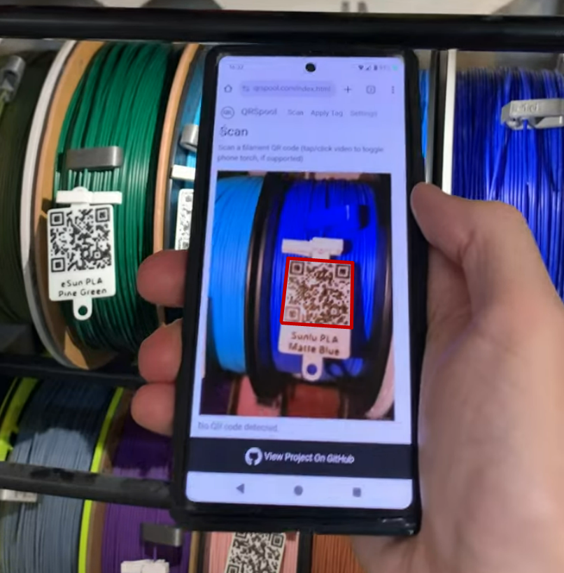
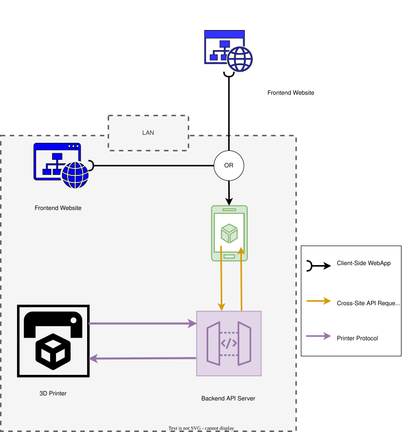

<div align="center">

# QRSpool


</div>

Update your 3D printer's filament slot settings by scanning a printed QR code or NFC tag with your phone. Point your camera at a filament code, then a slot code, and the printer updates its AMS settings instantly. Or use the REST API to change filament settings from your own independent project code.

> **Beta:** Fully functional for Bambu Labs printers in LAN+DEV mode (plus any printer running pre-January-2025 firmware). **Experimental** support for [cloud-connected printers](#command-signing-experimental). Please report any issues since I can't test with all printers.

## Table of Contents
- [What It Does](#what-it-does)
- [Requirements](#requirements)
- [Quick Start](#quick-start)
  - [Step 1: Set Up the Backend Server](#step-1-set-up-the-backend-server)
  - [Step 2: Connect the Frontend](#step-2-connect-the-frontend)
- [Configuration](#configuration)
  - [Top-level settings](#top-level-settings)
  - [Per-printer settings](#per-printer-settings)
  - [Choosing a backend](#choosing-a-backend)
  - [Command signing](#command-signing-experimental)
- [Scanning and Applying Filament](#scanning-and-applying-filament)
- [Creating Tags](#creating-tags)
  - [Filament QR Codes](#filament-qr-codes)
  - [Slot QR Codes](#slot-qr-codes)
  - [Printing Your Tags](#printing-your-tags)
  - [Attaching Tags to Spools](#attaching-tags-to-spools)
  - [NFC Tags](#nfc-tags)
- [Bambu Printer Notes](#bambu-printer-notes)
- [Technical Reference](#technical-reference)
  - [URL Parameters](#url-parameters)
  - [OpenTag3D Field Length Limits](#opentag3d-field-length-limits)
  - [Backend Server API](#backend-server-api)
  - [Backend Server Authentication](#backend-server-authentication)
  - [3rd Party Dependencies](#3rd-party-dependencies)

---

## What It Does

QRSpool has two components:

- **Frontend**: A website ([qrspool.com](https://qrspool.com)) that uses your phone's camera or NFC to scan filament tags. All image and tag processing happens locally in your browser; no camera data is ever sent to any server.
- **Backend server**: A small server you run on your home network that bridges the website and your printer(s).

The typical workflow:

1. 3D print some QR codes or write some NFC tags* and attach them to your filament spools and AMS slots
2. Scan the QR code (or tap an NFC tag) on a filament spool with your phone camera, right from your browser
3. Scan the QR code (or tap an NFC tag) on the slot you want the filament settings applied to
4. View and verify your printer's new AMS slot setting right from your phone

*Full NFC support is only available in Chrome on Android. Partial support is available on iOS and other browsers. See the [NFC Tags](#nfc-tags) section for more details.

You can also scan just a filament code/tag and then manually select a slot to apply it to on your phone. 

Click below for a quick demo video of the QR scanning process in action:

<a href="https://www.youtube.com/shorts/bS265bDV_I8"></a>

---

## Requirements

- **Printer:** A Bambu Labs printer in LAN+DEV mode
- **Server:** An always-on computer (server) on the same network as your printer, able to run either Docker (recommended) or Python ≥3.10
  - Will work best if it has a stable local IP address or DNS name
  - Air-gap friendly: Internet access only required for initial installation and updates
- **Phone:** Any modern smartphone with a camera
  - Use Chrome for the best experience; Firefox and Safari support the core QR scanning features with some limitations

---

## Quick Start

### Step 1: Set Up the Backend Server

The backend server translates data between the website and your printer. It runs on a computer on your home network.

```bash
git clone https://github.com/Aptimex/QRSpool.git
cd QRSpool/bambu-server
cp configs/bambu_config.example.json configs/bambu_config.json
```

Edit `configs/bambu_config.json` and fill in your printer's IP address, serial number, and access code, and set a username and password for the server. See [Configuration](#configuration) for the full list of available settings. Multiple printers can be configured, just ensure each printer entry in that file receives a unique name.

**Run it with [Docker](https://docs.docker.com/engine/install/ubuntu/) (recommended):**

```bash
sudo docker compose up --build -d
```

This starts the server on port 5123 using HTTP only. Configuration files are mounted live from the `configs/` folder and persist across container restarts. If you ever change a config, just run `sudo docker compose restart` to reload them. 

<details>
<summary>Running natively without Docker</summary>

You'll need **git** installed as well as Python 3.10+. Using a virtual `venv` environment is recommended.

```bash
cd bambu-server/
python3 -m venv .venv
source .venv/bin/activate          # Windows: .venv\Scripts\activate
python3 -m pip install -r requirements.txt
openssl req -new -x509 -keyout key.pem -out server.pem -days 3650 -nodes
flask run --host=0.0.0.0 --port=5123
```

</details>

> [!WARNING]
> The frontend and backend must both use HTTP or both use HTTPS. Mixing protocols will cause the browser to silently refuse communication in most browsers.

> [!WARNING]
> HTTP-only mode should only be used for testing out the project, unless you fully trust the security of your local network. Any device on your network can passively sniff your server credentials in every request when you use HTTP instead of HTTPS. 

**HTTPS certificate options** (uncomment the appropriate `CMD` line in the Dockerfile):
- **HTTP only** *(lowest friction to get started)*: No certificate needed. Use with `http://qrspool.com` (no `s` before the `:`) for the frontend. Upgrade to one of the HTTPS options below once you've decided you want to keep using this project. Remember, HTTP exposes your server credentials to anyone on the local network.
- **Real certificate via reverse proxy** *(recommended for continued use)*: Use a tool like [Caddy](https://caddyserver.com/) to add proper TLS. A free [DuckDNS](https://www.duckdns.org/) subdomain provides a real domain name to attach a certificate to. Step-by-step instructions for this kind of setup are [included in the repo here.](bambu-server/HTTPS.md)
- **Self-signed cert** *(only use for dev work)*: Works immediately, but requires a browser exception confirmation on every browser restart, which is really annoying. Usable for development work, not recommend for long-term use. 

### Step 2: Connect the Frontend

The frontend is already hosted at [qrspool.com](https://qrspool.com) (available over both HTTP and HTTPS) so you don't need to do any setup for that part on your end. But you can self-host that part too if you want.

1. Open **https://qrspool.com/settings.html** on your phone in Chrome (use **http://qrspool.com/settings.html** if your backend is HTTP-only)
2. Enter your backend server's URL (e.g. `https://192.168.1.100:5123`), username, and password
3. Tap **Save**, then **Validate** to confirm the connection works

> [!IMPORTANT]
> If your server uses a self-signed certificate, you'll need to open the server URL directly in your browser and accept the security warning. You may need to do this again each time your browser restarts. Using a real certificate with Caddy as described above avoids this nuisance entirely.

Go to the **Scan** tab and grant camera and/or NFC access as prompted. Now you're ready to go!

> [!TIP]
> Firefox and Safari support QR scanning, but lack torch (flashlight) control, vibrate-on-scan, and NFC scanning. Chrome on Android is recommended for the full experience.

**Prefer to host the frontend yourself?** Serve the `client/` folder with any web server. For example, `python3 -m http.server` or the included `https-server.py` script. That folder is fully self-contained with no external dependencies.

---

## Configuration

Please see the [`bambu-server/configs/README.md`](bambu-server/configs/README.md) file for full instructions for setting up your config file.

All server settings live in `bambu-server/configs/bambu_config.json`. Copy `bambu_config.example.json` to get started. The server validates the file at startup and refuses to run if there's a problem with that file. With Docker the whole `configs/` folder is mounted live; just run `sudo docker compose restart` after any change to reload it.

### Command signing *(experimental)*

Most users should turn on LAN + Developer mode and ignore this section. 

Bambu firmware released after roughly January 2025 (after the rollout of their "Authorization Control" changes) rejects unsigned state-changing commands unless the printer is in LAN + Developer mode (which disables all Bambu cloud features). Reading slot data still works, but writes are blocked. The server auto-detects whether the printer is in LAN+DEV mode; if it's not, and the required signing files are missing, it reports an error to the frontend.

> [!CAUTION]
> Supplying your own signing credentials requires key material from Bambu Studio that you must obtain yourself. Signing depends on protocol details that firmware updates may change. Proceed at your own risk.

<details>
<summary>Here be dragons (click to proceed)</summary>

**You need three PEM files:**

| File | Contents |
|---|---|
| `key.pem` | The private key that signs each command |
| `chain.pem` | The full certificate chain: leaf + intermediate + root. The leaf is extracted from it automatically, so it isn't configured separately. |
| `crl.pem` | Any signed certificate revocation list. Expired ones work fine. |

The contents of all these files must come from Bambu, there is currently no way to generate and use your own.

The `key` is normally the hardest thing to get, but currently can be easily obtained using the Linux code in [this project](https://github.com/danielwoz/BambuSlicerKeySaver).

The associated Linux `chain` and `crl` contents can currently be obtained by visiting the API URL [mentioned here](https://bambuzled.github.io/posts/bambu-auth-control/#the-current-cert-api) and parsing the JSON response.

**None of these signing files are included with this project, and requests for them will be ignored.**

**Setup:**

1. Put the three files in `bambu-server/configs/signing/`. That folder already exists and gets mounted into the container.
2. Point the top-level config keys at them:

   ```json
   "key_pem_file": "configs/signing/key.pem",
   "cert_chain_pem_file": "configs/signing/chain.pem",
   "crl_pem_file": "configs/signing/crl.pem",
   ```

All three are required together. The server refuses to start if only some are set, or if one of the paths can't be read. One certificate set covers every printer in the config that the server detects requires signing.

Older printers can only maintain one active trusted certificate at a time, and may delay new operations for up to 30s while processing the cert being used. For best results use the cert from the Bambu Studio version that you use the most; otherwise the server may temporarily lose its ability to send filament-change commands whenever Bambu Studio connects to the printer, and that delay for switching certs will be hit frequently.

I welcome bug reports related to this experimental signing functionality, but won't provide any support for the process of obtaining the required files.

</details>

---

## Scanning and Applying Filament

From the **Scan** tab, point your camera at a filament or slot QR code until you get a scan confirmation. Once you have scanned a pair, the scanned filament will be automatically applied to the scanned slot in the active printer. Alternatively, you can scan just a filament tag and then use the Apply page to manually select a printer/slot to apply it to. 

Scanning both tag types in either order causes the filament to be applied to the slot automatically. If you'd prefer to confirm before applying, there's a setting for that on the Settings page.

If you have multiple printers configured, you can manually change the active printer using the dropdown at the top of the page, or include the printer name in the slot QR code to auto-link it to a specific printer.

> [!TIP]
> Check out the Settings tab to customize various scan behavior options to best suit your preferred workflow. 

---

## Creating Tags

The **[Tag Builder](https://qrspool.com/tag.html)** page (dropdown on the top nav bar) can help you generate everything both filament and slot tags, for both printable QR codes and NFC tags. On Android with Chrome it can also write the data straight to an NTAG-type NFC tag. Lots of data is pre-populated or selectable using information queried from the backend server, if configured. For maximum compatibility, I recommend writing a URL Record and either an OpenSpool or Text record to each tag.

> [!CAUTION]
> Due to an intentionally-restrictive design of Bambu printer firmware, `TYPE` and `BRAND` must exactly match a profile name from the Bambu Studio filament dropdown. Matching against your custom profiles is a complicated and fragile endeavour, but [Bambu Printer Notes](#bambu-printer-notes) describes at a high level how you might be able to accomplish that.

### Filament QR Codes

Filament tags use a compact pipe-delimited format derived from [OpenSpool 1.0](https://openspool.io/rfid.html):

```
OS1.0|TYPE|COLOR_HEX|BRAND|MIN_TEMP|MAX_TEMP
```

Example:
```
OS1.0|PLA Matte|FF5733|Bambu|190|230
```

Fields are parsed left to right. You can omit fields from the right end, or leave individual fields empty if you don't need them. `OS1.0` is the format identifier the scanner uses to recognize compatible codes, so it's mandatory.

### Slot QR Codes

Slot tags identify a specific printer and/or AMS slot:

```
SLOT|IDS|PRINTER_NAME
```

Both `IDS` and `PRINTER_NAME` are optional, but at least one must be present for the tag to have any effect.

Full tag (switch active printer and then target a slot):
```
SLOT|{"amsID":0,"slotID":0}|My Printer
```

Slot only (applies to the current active printer):
```
SLOT|{"amsID":0,"slotID":0}|
```
- Optionally drop the final `|`

Just switch active printer:
```
SLOT||My Printer
```

The printer name must be the same value that you configured in the `bambu_config.json` file.

The easiest way to build one of these is the Tag Builder page, which lists your printer's slots in a dropdown. To find an `ids` value manually, open the Apply page and expand the "↓ Show/Hide All Slot Info ↓" section under any slot, then tap/click the value to copy it. 

> [!WARNING]
> Slot IDs are assigned by the printer itself and can change with firmware updates or AMS hardware changes (such as adding or removing a daisy-chained unit). Double-check that all your codes/tags still reference the expected slots after any hardware or firmware changes. 

If you have multiple printers configured, only one printer is "active" at a time, and switching printers can take anywhere from a few seconds to ~30s depending on the model and current printer state. For the fastest workflow, scan the filament tag first, then the slot tag.

### Printing Your Tags

[QR2STL](https://qrcode2stl.printer.tools/) generates printable 3D QR codes. A self-hostable fork (with ads and wait times removed) is also [available here](https://github.com/Aptimex/qrcode2stl). The Tag Builder page produces a compatible JSON dump with your filament's data and label already filled in, so you can paste it straight into that site and generate the model with all the correct settings and data pre-applied. Use the "Import/Export Settings" button at the top-right of the QR2STL webpage to import the generated JSON.

Tips for reliable scanning:
- **30×30mm** with a 0.4mm nozzle works well; smaller dimensions need a 0.2mm nozzle
- Use the **Arachne** wall generation method
- Use the lowest error correction level, or else increase the tag size to compensate for a denser code

### Attaching Tags to Spools

A custom clip with multiple attachment options for filament spools [is available for free on MakerWorld](https://makerworld.com/en/models/1408538-filament-clip-for-qrspool-tags). It's designed for QR2STL models with a 5mm keychain hole. Use the JSON generated by the tag builder to quickly generated a compatible model. 

> [!WARNING]
> Don't try to leave this clip on the filament when you put the spool in your AMS, they are not designed for that and will likely cause issues. However, if you are using an AMS Lite, on most spools they can be left clipped onto the outside edge of the spool. 

### NFC Tags

**On Android with Chrome**, the Scan and Apply pages show a button to enable NFC scanning. Once enabled, tapping an NFC tag works just like scanning a QR code with the camera. This only works with [NTAG-type tags](https://www.nxp.com/products/NTAG213_215_216), NOT the (more expensive) Mifare Classic tags used by Bambu. The Web NFC library does not support any RFID tag types other than NTAG.

> [!IMPORTANT]
> The Web NFC API only works when the website is using HTTPS, or is running on `localhost`. So you must also be using HTTPS (self-signed cert works) on your backend server to make use of this feature when using QRSpool.com.

QRSpool currently supports several different NFC formats:
- Tags containing the same plain text string as a QR code
- [OpenSpool](https://openspool.io/rfid.html#protocol) tags (an `application/json` record)
- [OpenTag3D](https://opentag3d.info/spec) tags; but see [OpenTag3D Field Length Limits](#opentag3d-field-length-limits) for important notes if you're using OpenTag3D with a Bambu printer
- URL records pointing at qrspool.com with filament and/or slot data in the [URL parameters](#url-parameters)

**Writing NFC tags from QRSpool:** on Android with Chrome, the [Tag Builder](https://qrspool.com/tag.html) page writes both filament and slot tags directly. Pick which data formats to include, click Write NFC Tag, and hold a tag against the back of your phone. **It will silently overwriting any existing data on the tag.** Each selected format becomes its own NDEF record on the same tag, so one tag can serve both native phone handling and QRSpool's dedicated NFC scanner seamlessly. The page also shows an approximate byte count so you can tell whether your selection will fit on the specific NTAG you're using.

**Combined tags:** the slot section has a *Combined tag* switch that combines the filament data into the slot tag data, so a single tap applies that filament to that slot with no second scan. I haven't come across a real use case for this yet, but it's supported.

To write tags using a different device, use a general-purpose NFC app like [NFC Tools](https://play.google.com/store/apps/details?id=com.wakdev.wdnfc) or [NFC TagWriter](https://play.google.com/store/apps/details?id=com.nxp.nfc.tagwriter), and copy the tag data out of the Tag Builder page. If you want to write OpenTag3D tags, you can instead use the [OpenTag3D Make tab](https://opentag3d.info/make).

**On iOS (and any phone without in-browser NFC):** Write URl Records as the first record in the NFC tags. [NFC Tools](https://apps.apple.com/us/app/nfc-tools/id1252962749) and [NFC TagWriter](https://apps.apple.com/us/app/nfc-tagwriter-by-nxp/id1246143221) are also available in iOS for this purpose. A tag containing a URL like this will open the site with filament data pre-loaded when tapped, and does not require you to already have the website/browser open.

Example filament tag string:
```
https://qrspool.com?qrstring=OS1.0|PLA|FF5733|Bambu|190|230
```

Example slot tag string:
```
https://qrspool.com?&slotstring=SLOT|{"amsID":0,"slotID":1}|My Printer
```

You can even combine filament and slot data in a single URL to auto-apply on tap, if you have a need to do so:

```
https://qrspool.com?qrstring=OS1.0|PLA|FF5733|Bambu|190|230&slotstring=SLOT|{"amsID":0,"slotID":1}
```

> [!TIP]
> NFC tags support multiple NDEF records. You can set the first record to a URL (for native smartphone handling) and the second to a plain-text QR string, or one of the other supported formats. Most native phone scans will only process the first record (the URL), while QRSpool.com reads through the records in order and uses the first one it recognizes, giving you maximum compatibility with both approaches across all phones in one tag. The Tag Builder page writes tags in exactly this layout.

See also the [URL Parameters](#url-parameters) section for additional supported URL formats available for power users. 

---

## Bambu Printer Notes

**Filament code matching:** `BRAND` and `TYPE` in a tag must match a profile name from Bambu Studio exactly (e.g. `Bambu` + `PLA Matte`). The server combines them and looks up the internal code (`GFA01` in this example) in the `bambu-server\configs\bambu-ams-codes.json` file. **None of the settings set in the tag data have any actual effect on prints, everything is controlled by the slicer based on the profile settings.** However, the min/max nozzle temps are used when you use the printer touchscreen to load/unload a filament slot.

If an exact code match fails, the server tries these fallbacks in order:
1. Replace the brand with `Generic` and search again
2. Treat the `TYPE` field directly as a filament code
3. If `BRAND` is `RAWCODE`, assumes `TYPE` contains the exact internal code (like `GFA01`; also useful for [custom AMS profiles](https://forum.bambulab.com/t/how-to-add-custom-filaments-so-you-can-select-them-in-the-ams/52140))

If all fallbacks fail, the server returns an error. 

It is possible to match against custom profiles, but complicated. Essentially you have to make one from scratch (not based on an existing profile) and then identify the internal code assigned to it (should start with `P`). Then you can either manually add a brand+type mapping to that code in the server's `bambu-server\configs\bambu-ams-codes.json` file, or write the `RAWCODE` directly to your tags. Note that only slicers that have a local copy of that profile (assigned to that code) will be able to use/recognize it, and may silently overwrite the printer's internal storage of that code to a generic profile code if they don't.

> [!NOTE]
> In testing, unrecognized/invalid raw codes were save to the printer but silently ignored by the slicer and never caused any problems. 

**Empty slot limitation:** Currently-empty slots can't have their filament settings changed. Make sure filament is finished loading before trying to apply a tag to the slot. 

**Auto-detected spools:** Since official Bambu spools that are read by the AMS directly come with some benefits (such as native remaining-filament tracking) that can't be directly replicated via MQTT, by default the server will not let you write different filament data to auto-detected slots. If you want to be able to do so, set `"overwrite_auto_filament": true` for the target printer in your JSON config. The server also rejects change requests that are sent while the printer is actively trying to read the target slot (not configurable).

---

## Technical Reference

This section covers implementation details for developers who want to build compatible servers or clients.

QRSpool's frontend and backend are intentionally decoupled: the frontend handles all QR/NFC parsing and generates standard REST requests to the backend; the backend translates those REST requests into whatever protocol a given printer needs. A backend server for a different printer brand could be built without changing the frontend at all (in theory).



### URL Parameters

The scan page accepts pre-loaded data via URL parameters:

| Parameter | Format |
|---|---|
| `?qrstring=X` | Same string as a filament QR code |
| `?osjson=X` | OpenSpool JSON string (no line breaks) |
| `?type=A&color_hex=B&brand=C&min_temp=D&max_temp=E` | Individual OpenSpool fields (`type` key required) |
| `?slotstring=X` | Same string as a slot QR code, including the `SLOT` prefix |

One filament parameter (`qrstring`, `osjson`, or the individual fields) and `slotstring` can be combined in a single URL to apply a pair in one step. The filament half is stored first, so the slot half decides when the pair is complete. Values should be percent-encoded; the `|` delimiter is safe to leave as-is.

### OpenTag3D Field Length Limits

OpenTag3D limits the Material Name and Modifier fields to 5 characters, which many Bambu filament names exceed. Options when a value doesn't fit:

1. **Truncate to 5 characters**: works if only one possible expansion exists; the server returns an error if the truncation could correspond to more than one known value
2. **Use a recognized abbreviation**: e.g. `Supp` → `Support`, `HiSpd` → `High Speed`, `Tgh+` → `Tough+`; see `bambu-server/configs/type-abbreviations.json` and `modifier-abbreviations.json` for the full list. You can add your own abbreviations to this file too
3. **Use the Color Name field**: put the full Manufacturer and Type there first and leave the dedicated fields blank; the server will attempt to match it
4. **Use RAWCODE**: set Name to `RAWCODE` and put the code from `bambu-ams-codes.json` in the Type field

### Backend Server API

Data in `<>` should be replaced with appropriate values; everything else is a literal string.

#### GET /serverStatus *(unauthenticated)*

Returns server status and authentication information. This is the endpoint hit when the user validates their server settings.

```json
{
    "status": "running",
    "authRequired": "<true|false>",
    "authCorrect": "<true|false>",
    "serverVersion": "<SemVer version string>"
}
```
- `authRequired`: whether other endpoints enforce Basic Auth. 
- `authCorrect`: whether the credentials in this request (optional here) are valid.
- `serverVersion`: allows the frontend to detect when the backend is outdated and alert the user, without requiring any network-based update checks. 

#### GET /printerStatus

On success:
```json
{
    "status": "<statusMessage>"
}
```

If an error is encountered, optionally retun an error field instead:
```json
{
    "error": "<errorMessage>"
}
```

#### GET /slots

Returns available filament slots. `ids` and `displayID` are mandatory per slot; all others are optional, but you need to return enough other data fields to be useful to the user.

```json
{
    "slots": [
        {
            "ids": { "<OPAQUE>": "<OPAQUE>" },
            "displayID": "<value>",
            "<dk1>": "<value>",
            "<dk2>": "<value>",
            "<otherKey>": "<value>"
        }
    ],
    "displayKeys": ["<dk1>", "<dk2>"],
    "colorHexKeys": ["<dk2>"]
}
```

- `ids`: opaque object uniquely identifying the slot; the frontend copies it into `/setFilament` requests unchanged
- `displayID`: human-readable slot identifier; should correspond to physical numbering or markings on the hardware if they exist
- `displayKeys`: important slot fields to display by default in the slot selection UI
- `colorHexKeys`: fields whose values are 6-digit hex color codes and should be rendered as colors in the UI

#### POST /setFilament

```json
{
    "ids": { "OPAQUE": "OPAQUE" },
    "type": "<value>",
    "colorHex": "<value>",
    "brand": "<value>",
    "minTemp": "<value>",
    "maxTemp": "<value>"
}
```

This route returns once the printer has **accepted** the command, not (necessarily) once it has actually finished applying it. Bambu printers commonly take several seconds to reflect a filament change and may report the slot as empty until that finishes, so a server should not cause a delay waiting for that confirmation. The frontend is responsible for verifying success via the `/slots` route and accounting for this potential delay.

Field values may be empty strings if data was omitted from the scanned tag. The server must silently ignore unknown keys, and may support more than these. Currently recommended optional fields for maximum compatibility:

```json
{
    "colorName": "<value>",
    "bedTemp": "<value>"
}
```

#### GET /reconnect

Tells the server to disconnect and reconnect to the printer. No parameters. Intended as a quick-fix when things aren't working as expected.

#### GET /printers

Returns the list of configured printer names. Used by the frontend to populate the printer selector dropdown.

```json
["My Printer", "Workshop Printer"]
```

#### GET /activePrinter

Returns the name of the currently active printer.

```json
{
    "name": "My Printer"
}
```

#### POST /activePrinter

Switches the active printer. Server will tear down the connection to the current printer and establishes a new connection to the target printer.

```json
// Request
{ "name": "Workshop Printer" }

// Response
{ "name": "Workshop Printer" }
```

If the requested printer name is not recognized, the server returns an error with the list of known printers (lookup is case-insensitive):

```json
{
    "error": "Unknown printer 'SomePrinter'. Known printers: ['My Printer', 'Workshop Printer']"
}
```

### Backend Server Authentication

The server uses standard [HTTP Basic Authentication](https://en.wikipedia.org/wiki/Basic_access_authentication). All endpoints except `/serverStatus` require:

```
Authorization: Basic <base64(username:password)>
```

Credentials and settings are stored in the browser's `localStorage`, not cookies, to avoid incidental exposure to the frontend's website server.

The server does not rate-limit bad authentication requests, so is potentially vulnerable to brute-force authentication attacks. Use a strong password and don't expose the server to the Internet.

## 3rd Party Dependencies

- [jsQR](https://github.com/cozmo/jsQR): QR code decoding from the camera feed (frontend)
- [Bootstrap](https://getbootstrap.com/): UI framework (frontend)
- [bambu-mqtt-comms](https://github.com/Aptimex/bambu-mqtt-comms) + [bambu-mqtt-generator](https://github.com/Aptimex/bambu-mqtt-generator): MQTT connection handling, payload generation and signing for printers on the default `"custom"` backend. Not published to PyPI, `requirements.txt` installs them directly from GitHub, so pip needs `git` available.
- [paho-mqtt](https://pypi.org/project/paho-mqtt/) and [cryptography](https://pypi.org/project/cryptography/): underlying MQTT transport and signing primitives, pulled in automatically by those two
- [bambulabs-api](https://pypi.org/project/bambulabs-api/) ≥2.6.2: A secondary Bambu printer communication library, for older-firmware LAN-only printers. **Temporarily installed from a [fork](https://github.com/Aptimex/bambulabs_api)** rather than PyPI, pending an [upstream fix](https://github.com/BambuTools/bambulabs_api/pull/180).

## AI Disclaimer

The custom libraries were largely vibe-coded using Claude with the goal of translating relevant features from Bambu Studio source code to Python libraries. All code in this project prior to ~April 2026 was written by me; most code added after that date was written by Claude in small batches based on my careful instructions and reviewed/tested at each step. All documentation in this project has been either written directly or heavily edited by me. 

The overall functionality of all code has been extensively tested both by me and by Claude against my own printers. Claude has been able to catch and fix far more bugs than I ever could have on my own.
